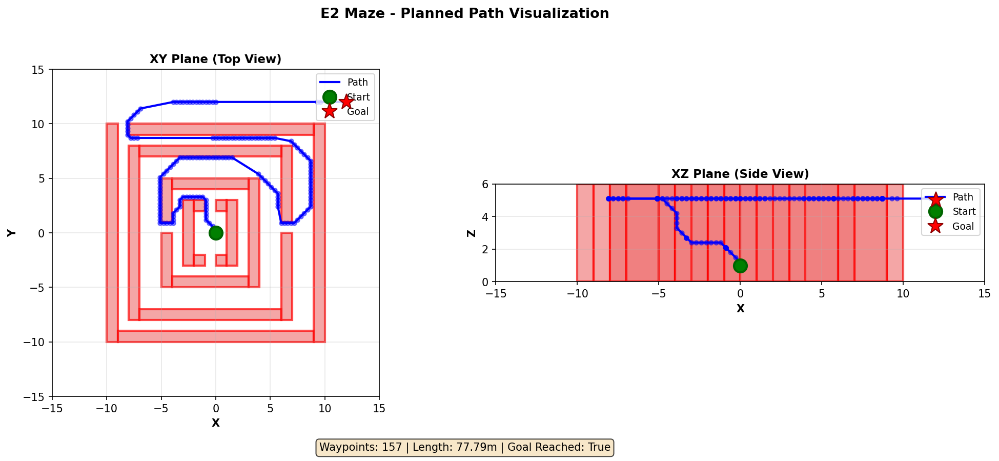
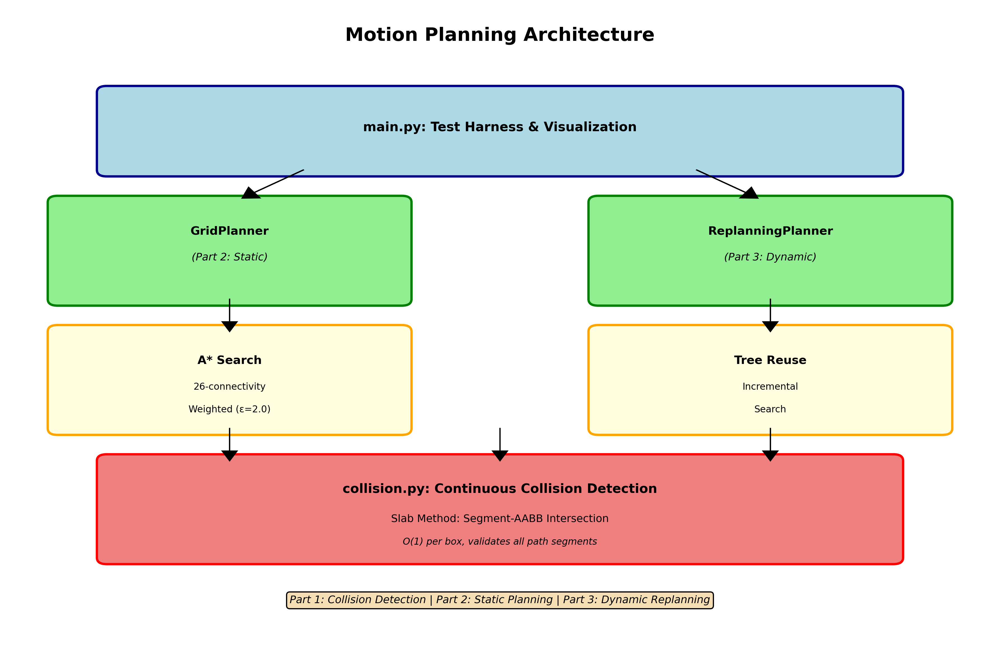
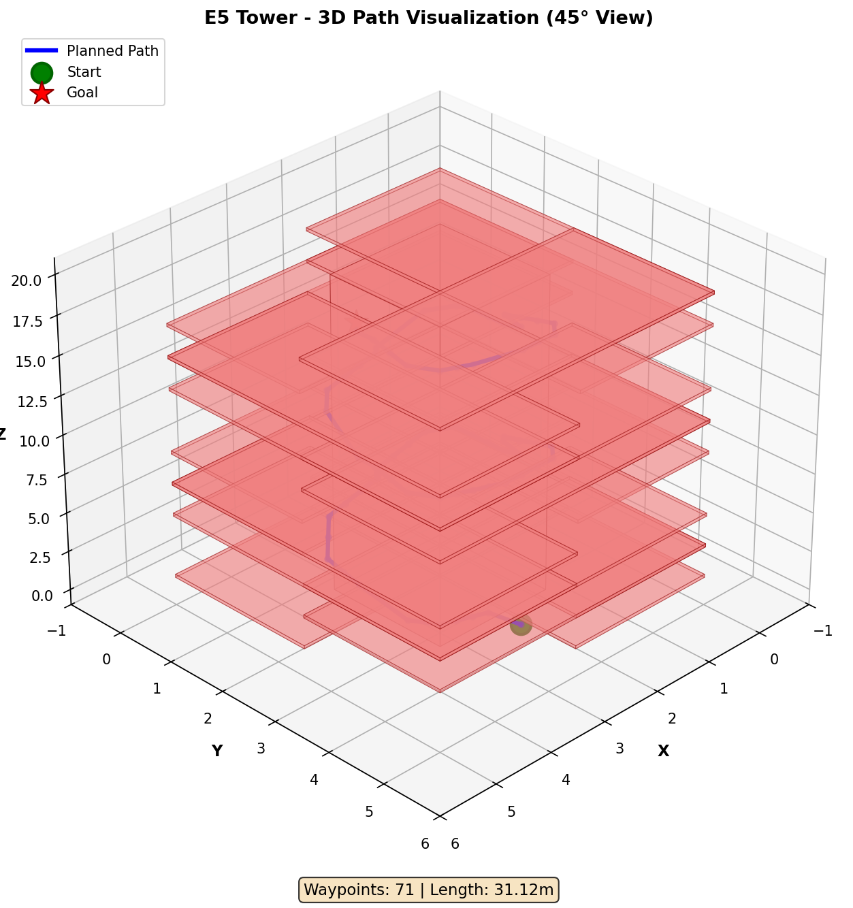

# 3D Motion Planning and Replanning

**UC San Diego ECE 276B · Project 2**

A motion planner for 3D environments with box obstacles and changing targets. It combines weighted A* on a 26-connected grid, continuous segment–box collision checks, path shortcuts, and a planner that reuses search state between goals.



*E2 maze: top and side views of a planned route around obstacles. This image is an example result from the project.*

## How it works

1. `collision.py` tests line segments against axis-aligned boxes with the slab method. Edges and shortcut segments are checked in continuous space.
2. `planner.py` searches a 26-connected 3D grid with a diagonal-distance heuristic and a configurable heuristic weight. It reconstructs a path and can remove unnecessary waypoints with collision-checked shortcuts.
3. `replanner.py` carries cost, parent, and frontier information forward as the target changes. It supports a time budget and reports partial paths when the budget expires.



## Run it

Use Python 3.11 or 3.12:

```bash
python -m venv .venv
python -m pip install -r requirements.txt
python test_planner.py
```

For the original interactive map harness, run from `starter_code/`:

```bash
cd starter_code
python main.py
```

The harness defaults to the E7 room dynamic-target example. It opens a Matplotlib window; select a different `test_*` call in `main.py` to try another map. Seven text maps are included in `starter_code/maps/`.

The smoke script checks segment–box intersection and basic static and dynamic planner behavior. It passed locally before publication. The example images illustrate runs from the original coursework; timing and path length depend on the map, settings, and machine.



The map harness and map files come from ECE 276B starter materials. The collision checker and planners are the project implementation.

**Related projects:** [Door-Key Planning](https://github.com/michaelyuuu/ECE-276B_Door-Key-Planning) · [Robot Trajectory Tracking](https://github.com/michaelyuuu/ECE-276B_Robot-Trajectory-Tracking)
